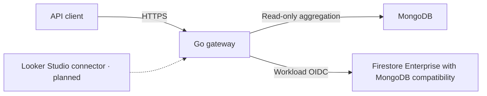

# Mongo Looker Connector

**Query MongoDB where it lives.** This self-hosted Go gateway gives reporting tools a tabular view of the collections you choose. Your company owns the deployment, database credentials, and data. Each report runs directly against its source.

[Quickstart](#run-your-first-query) · [HTTP API](docs/api.md) · [Query reference](docs/query.md) · [Terraform deployment](deploy/terraform/README.md) · [Roadmap](docs/roadmap/README.md)

## Run your first query

With Docker Compose and curl installed, run these commands from the repository root. The demo starts the gateway on `127.0.0.1:8080` and seeds a local MongoDB with two synthetic orders.

```sh
docker compose up --build --detach --wait

curl --fail-with-body --json '{
  "connectionId": "demo",
  "database": "analytics",
  "collection": "orders",
  "pipeline": [{"$match": {"_id": "order-001"}}],
  "fields": ["amount", "_id"]
}' http://127.0.0.1:8080/api/v1/query
```

The response preserves the requested column order.

```json
{"fields":["amount","_id"],"rows":[[42,"order-001"]]}
```

Try `GET /api/v1/connections` to discover the configured connection, or send the same namespace to `POST /api/v1/schema` to inspect its fields. Run `docker compose down --volumes` to remove the demo. The bundled credentials and records are for this disposable fixture.

## How a query reaches your data



Operators give each connection an ID, a reference to its credential environment variable, and a database and collection allowlist. The gateway uses the same scope for discovery, schema sampling, and queries. It flattens nested fields, preserves high-precision numeric values as text when needed, and caps execution time and response size.

| Source | v0.1 verification |
| --- | --- |
| Self-hosted MongoDB | Docker smoke covers discovery, schema inference, an exact query result, and denial of access to an unlisted collection. |
| Firestore Enterprise with MongoDB compatibility | The sandbox smoke exercises a named database through Cloud Run with workload identity and read-only IAM. See the roadmap for run evidence. |
| MongoDB Atlas | Uses the MongoDB driver connection path. An Atlas deployment is a separate verification milestone. |

**Looker Studio integration is planned for v0.3.** The v0.1 interface is the HTTP gateway. The [roadmap](docs/roadmap/README.md) follows the project through the administration console, managed datasets, and the self-hosted v1.0 release.

## Deploy on Google Cloud

The [Terraform guide](deploy/terraform/README.md) covers the state bucket, Artifact Registry, dedicated database identity, and IAM-protected Cloud Run service. Build the image once, deploy its digest, and use the synthetic fixture to verify the revision in your own project. Local MongoDB testing works without a Google Cloud account.

## Contribute

Read the [branch and release guide](AGENTS.md) before opening a PR. The [maintainer playbook](SKILLS.md) lists the checks for API, provider, infrastructure, and release changes. User-visible changes go in the [changelog](CHANGELOG.md).

Released under the [Apache License 2.0](LICENSE).
