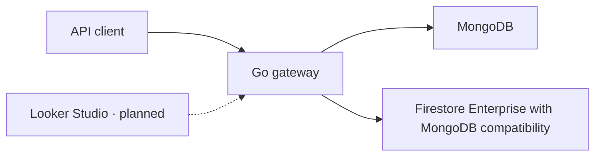

# Mongo Looker Connector

**A self-hosted MongoDB analytics gateway for Looker Studio.** Run it in your own Google Cloud project, query the collections you choose, and keep credentials under your control.

[Roadmap](docs/roadmap/README.md) · [Changelog](CHANGELOG.md) · [Contributor guide](AGENTS.md) · [Apache 2.0](LICENSE)

## What we are building

The first milestone is a read-only Go gateway. Operators configure named database connections and the collections available through each one. Clients discover those collections, infer a tabular schema and run bounded aggregation queries. The web administration console, managed datasets and generic Looker Studio connector follow in later milestones.

See the [roadmap](docs/roadmap/README.md) for implementation status and verification evidence.
