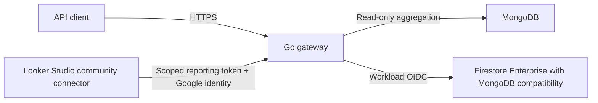

# Mongo Looker Connector

**Query MongoDB where it lives.** This self-hosted Go gateway gives reporting tools a tabular view of the collections you choose. Your company owns the deployment, database credentials, and data. Each report runs directly against its source.

[Administration console](docs/administration.md) · [Managed datasets](docs/datasets.md) · [Quickstart](#run-your-first-query) · [HTTP API](docs/api.md) · [Query reference](docs/query.md) · [Terraform deployment](deploy/terraform/README.md) · [Roadmap](docs/roadmap/README.md)

## Build a report from the workspace

Open the hosted console and sign in with your team account. Select a collection, add a **Match**, **Sort**, or **Group** stage with the stage builder, or edit the aggregation as JSON. **Run preview** displays the result rows and field types. Choose **Open in Looker Studio** to save the pipeline as a dataset and open its preconfigured data source. Owners grant reporting access by dataset and field. [Console guide](docs/administration.md) · [Looker Studio setup](docs/looker-studio.md#use-a-gateway-url-and-reporting-key)

To join data from another collection, choose **Join collections** and select the two matching fields. **Explain** shows the indexes the database used and how many documents it examined. The sandbox includes an orders-to-shipping-regions example. [Try the join](docs/query.md#join-two-collections-and-inspect-an-execution-plan)

### Start a new workspace

```sh
python3 deploy/selfhost/init.py --owner admin@example.org
```

The installer creates the MongoDB catalog and generates a first-use owner password. Open the local console, choose your own password and add teammates under **Team members**. For Google Cloud installations, the Terraform guide covers the hosted service and the operator’s initial owner setup. [Self-hosting guide](deploy/selfhost/README.md) · [Terraform deployment](deploy/terraform/README.md)

## Publish a managed dataset

Turn a collection into a reporting view with a saved aggregation and a fixed schema. In the admin console, publish a dataset, then issue a token for its permitted fields. In Looker Studio, choose **Published datasets → your dataset**. Repeated identical gateway queries can use a token-isolated cache for up to 60 seconds. [Publish the orders example](docs/datasets.md)

Report authors with a raw collection grant can also choose **Custom aggregation** during Looker Studio data source setup and paste a MongoDB pipeline. That data source uses the pipeline’s output fields in charts. [Try a custom aggregation](docs/looker-studio.md#enter-a-custom-aggregation)

## Run your first query

With Docker Compose and curl installed, run these commands from the repository root. The demo starts the gateway on `127.0.0.1:8080` and seeds a local MongoDB with two synthetic orders.

```sh
docker compose up --build --detach --wait

curl --fail-with-body --json '{
  "connectionId": "demo",
  "database": "analytics",
  "collection": "orders",
  "pipeline": [{"$match": {"_id": "order-001"}}],
  "fields": ["amount", "_id"]
}' http://127.0.0.1:8080/api/v1/query
```

The response preserves the requested column order.

```json
{"fields":["amount","_id"],"rows":[[42,"order-001"]]}
```

Try `GET /api/v1/connections` to discover the configured connection, or send the same namespace to `POST /api/v1/schema` to inspect its fields. Run `docker compose down --volumes` to remove the demo. The bundled credentials and records are for this disposable fixture.

## How a query reaches your data



Operators define named connections and their database and collection allowlists in the console or deployment configuration. Managed credentials are stored in Secret Manager. The gateway uses the same scope for discovery, schema sampling, and queries. It flattens nested fields, preserves high-precision numeric values as text when needed, and caps execution time and response size.

| Source | Verification |
| --- | --- |
| Self-hosted MongoDB | Docker smoke covers discovery, schema inference, an exact query result, and denial of access to an unlisted collection. |
| Firestore Enterprise with MongoDB compatibility | The sandbox smoke exercises a named database through Cloud Run with workload identity and read-only IAM. See the roadmap for run evidence. |
| MongoDB Atlas | Uses the MongoDB driver connection path. An Atlas deployment is a separate verification milestone. |

**Connect a Looker Studio report.** Install the Apps Script community connector against your private gateway, enter a collection-scoped token, then select the connection, database, and collection. Select a BSON date field to enable report date ranges. [Connector setup](docs/looker-studio.md) · [Roadmap](docs/roadmap/README.md)

## Deploy on Google Cloud

The [Terraform guide](deploy/terraform/README.md) covers the state bucket, Artifact Registry, dedicated database identity, and IAM-protected Cloud Run service. Build the image once, deploy its digest, and use the synthetic fixture to verify the revision in your own project. Local MongoDB testing works without a Google Cloud account.

## Contribute

Read the [branch and release guide](AGENTS.md) before opening a PR. The [maintainer playbook](SKILLS.md) lists the checks for API, provider, infrastructure, and release changes. User-visible changes go in the [changelog](CHANGELOG.md).

Released under the [Apache License 2.0](LICENSE).
